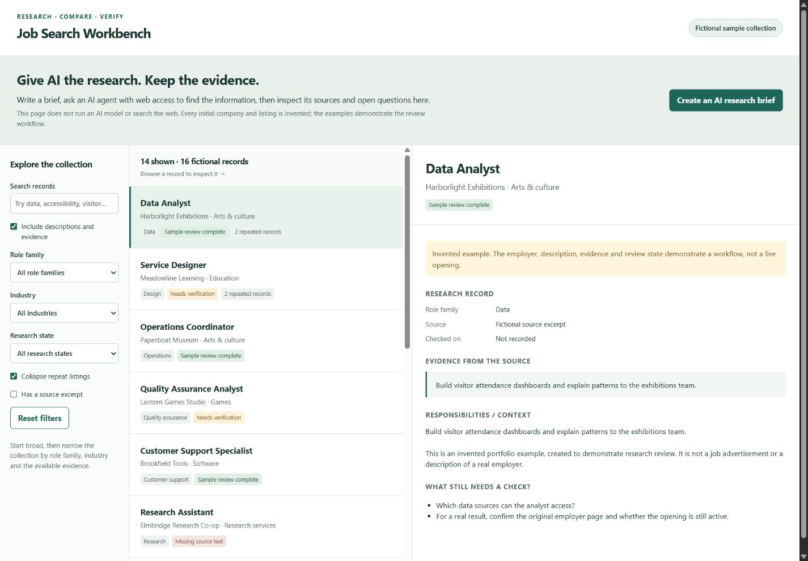

# Job Listing Research

**Give AI the research. Keep the evidence.**

A search tool for job listings. Brief an AI agent with web access to find and read original job postings, then bring its structured results back here to compare responsibilities, source evidence, repeated listings and unanswered questions. It only finds and organizes listings.

## Public demo

[Open the live demo](https://kobinkempe.pages.dev/job-search-workbench/) · [Read the case study](https://kobinkempe.pages.dev/case-studies/job-search-workbench/)



The initial collection contains **16 fictional records** across data, design, operations, writing, research and other general role families. Employers, excerpts and review states are invented. It includes repeats and missing evidence to make the comparison tools useful. There is no personal target profile, preferred location, compensation baseline, resume or application history in this public demo.

## Why I built it

A title or search snippet is not enough to understand an opening. The original project made AI-assisted research and a messy set of source records easier to inspect. The generic portfolio version presents that useful loop without reproducing my own search: ask a question, research it, preserve sources, and question the result.

## Try the workflow

1. Open **Create an AI research brief** and choose an example or write a question.
2. Download or copy the brief into an AI agent with web access. The agent must find current openings and read original employer or ATS pages; the browser app does not perform that search.
3. Ask the agent to return the JSON format specified in the brief, including source URLs, check dates, short excerpts, descriptions and open questions.
4. Import the file. All imported records start as **Needs verification**, regardless of any status supplied by the AI.
5. Inspect a description and its evidence, open the original source, filter by role or industry, search the text and collapse repeated listings.

Imported results stay in memory in the current tab. Refresh resets them. There is no model API, account, backend upload or persistent store in the public demo. An AI-produced URL or quote still needs a human source check.

## Run locally

Python 3.10 or newer, standard library only:

```sh
python serve.py
```

Open http://localhost:8766. `--open` opens the browser; `JOB_VIEWER_PORT` changes the port. The server serves the generic `demo/` directory on loopback. You can also serve `demo/` with any static web server. No research collection or API access is needed to try the fictional examples.

## Optional local collection and scoring pipeline

The Python tools retain the original idea of collecting descriptions, joining observations, scoring explicit signals and reviewing uncertain matches. The reusable source has **no built-in applicant profile, employer seeds, target roles, preferred locations, excluded locations, experience cutoffs or compensation baseline**. With no criteria file, every record is retained with score zero. Rules are choices supplied by the person running the tool, not recommendations about who should apply.

Try the offline pipeline with the same fictional records used by the demo:

```sh
python filter_jobs.py --postings demo/data.json --criteria examples/criteria.example.json
python build_final.py --postings demo/data.json
python build_viewer_data.py
python -m unittest discover -s tests -v
```

This writes only to ignored `local-data/`. Import `local-data/research-import.json` through the demo to inspect the results; all records become **Needs verification**. The fixture files stay unchanged. For real collection, supply your own board inventory, query and criteria in ignored `local-config/`. See [the pipeline and configuration guide](docs/PIPELINE.md) for supported adapters, file shapes, commands and limitations.

## Source layout

- `demo/`: current public browser experience and the 16-record fictional collection.
- `viewer/`: a mirror of the generic browser files for source compatibility; builders do not overwrite it.
- `serve.py`: loopback-only static server for `demo/`, with no persistence endpoint.
- `companies.py`, `fetch_jobs.py`, `fetch_all.py`: explicitly configured public ATS collection adapters.
- `filter_jobs.py`: optional transparent scoring, with empty neutral defaults.
- `build_final.py`: source joining, URL deduplication, candidate-match confidence and retained missing rows.
- `build_viewer_data.py`: browser-import export; all results remain unverified.
- `examples/`: empty board/seed inventories and neutral criteria, safe to copy and customize locally.
- `tests/`: offline checks using invented records and mocked adapters.

No original caches, scraped descriptions, resumes, saved searches or personal target lists are bundled. Keep your real records and configuration outside public Git history.

## AI and verification boundaries

AI assists discovery, reading, research intake and development. Browser filtering and duplicate grouping use ordinary JavaScript. The app cannot establish that a source is accurate, a listing is current or an applicant is eligible. Source excerpts and open questions make those checks visible.

The JSON importer limits size and record count, rejects non-HTTP source links, renders fields as text and forces imported review status to unverified. No live scraping or model invocation is needed for local checks.
